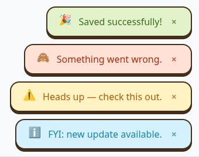

# heytoasty

A tiny vanilla JS/TS toast notification library with zero dependencies — the package injects its own CSS, works in any framework (React, Vue, Svelte, Angular, plain JS), and ships as ESM + CJS with full TypeScript types.

- **Live demo:** https://heytoasty.sejan.workers.dev/



## Install

```bash
npm install heytoasty
```

## Usage

```ts
import { toast } from 'heytoasty';

toast.success('Saved!');
toast.error('Something went wrong');
toast.warning('Heads up');
toast.info('FYI');

// Generic form
toast.show('Custom', { type: 'info', duration: 6000, position: 'top-right' });
```

CSS is injected automatically on first use — no stylesheet to import, no setup required.

## API

| Method | Description |
| --- | --- |
| `toast.show(message, title?, options?)` | Generic toast, type via `options.type`. Pass a title as 2nd arg or `options.title`. |
| `toast.success(message, title?, options?)` | Green toast with 🎉 (default icon) |
| `toast.error(message, title?, options?)` | Red toast with 🙈 |
| `toast.warning(message, title?, options?)` | Yellow toast with ⚠️ |
| `toast.info(message, title?, options?)` | Blue toast with ℹ️ |
| `toast.dismissAll()` | Remove every toast |
| `toast.setPosition(position)` | Default position for future toasts |
| `toast.configure(defaults)` | Global defaults applied to every toast |

Each call returns `{ dismiss, element }` so you can dismiss a single toast programmatically.

### Title

Title can be passed as the 2nd positional arg or in `options.title`. When set, it renders as a visible heading above the message (and as the element's `title` attribute for the native tooltip).

```ts
toast.success('Saved!', 'Your file is ready');
toast.error('Upload failed', 'Something went wrong');
toast.show('Details', 'Heads up', { type: 'warning' });

// Equivalent via options
toast.success('Saved!', { title: 'Your file is ready' });
```

The positional title takes precedence over `options.title`.

### Options

| Option | Type | Default | Notes |
| --- | --- | --- | --- |
| `title` | `string` | — | Optional heading shown above the message. Also set as the element's `title` attribute. |
| `type` | `'success' \| 'error' \| 'warning' \| 'info'` | `'success'` | Color scheme + default icon. On `show` only — the typed helpers (`success`, `error`, `warning`, `info`) set it for you. |
| `duration` | `number` (ms) | `4000` | `0` or `Infinity` = sticky (never auto-dismiss). Pauses on hover. |
| `position` | `'bottom-right' \| 'bottom-left' \| 'top-right' \| 'top-left' \| 'top-center' \| 'bottom-center'` | `'bottom-right'` | Per-toast or global via `setPosition`. |
| `dismissible` | `boolean` | `true` | Shows a × close button. |
| `icon` | `string` | per-type default | Pass `''` to hide the icon, or any emoji/string to override. |
| `bgColor` | `string` (CSS color) | per-type default | Overrides the toast background. Any valid CSS color (e.g. `#0f172a`, `rgb(15,23,42)`). |
| `txtColor` | `string` (CSS color) | per-type default | Overrides the toast text color. Any valid CSS color. |
| `progress` | `boolean` | `false` | Show a thin progress bar that depletes over `duration`. Hidden for sticky toasts (`duration: 0` / `Infinity`). Pauses on hover like the timer. |
| `onOpen` | `() => void` | — | Called once the toast becomes visible (after the enter transition). |
| `onClose` | `(reason: 'timeout' \| 'manual') => void` | — | Called when the toast is dismissed. `reason` is `'timeout'` (auto-dismiss) or `'manual'` (close button, `handle.dismiss()`, etc.). |

Per-type defaults are kept unless `bgColor` / `txtColor` are passed — set them globally with `toast.configure({ bgColor, txtColor })` or per toast:

```ts
toast.success('Dark mode', { bgColor: '#0f172a', txtColor: '#e2e8f0' });
```

## Example: configure once

```ts
import { toast } from 'heytoasty';

toast.configure({ position: 'bottom-left', duration: 5000 });
toast.success('All set!', 'Done');
```

## Progress bar & callbacks

```ts
toast.success('Uploading…', 'Almost there', {
  progress: true,
  duration: 5000,
  onOpen: () => console.log('toast shown'),
  onClose: (reason) => console.log('toast closed:', reason), // 'timeout' | 'manual'
});
```

## Development

```bash
NODE_ENV=development npm install
npm run build    # tsup → dist/index.{js,cjs,d.ts}
npm test         # vitest
npm run typecheck
```

The demo at `index.html` imports the built output from `./dist/index.js`. After building, serve the project root — **not** `index.html` directly:

```bash
php -S localhost:8000 -t .
# or
npx serve .
```

Don't pass `index.html` as the router (`php -S localhost:8000 index.html`) — that serves the HTML file for every request, including `/dist/index.js`, which breaks module loading with a MIME-type error.

## License

MIT
